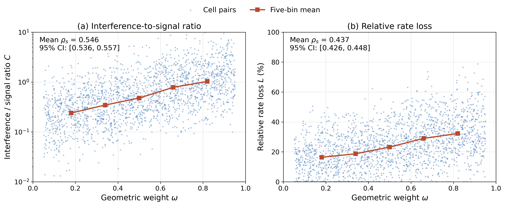
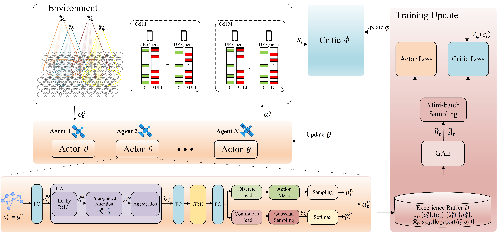

# Response to Reviewers

Paper: TCCN-TP-26-1155

Manuscript title: Hierarchical Load Balancing and Cooperative Beam Hopping for Multi-Satellite Direct-to-Cell LEO Networks

## Reviewer 1

### Comment 1.1

> The static association derived from long-term traffic statistics inevitably degrades as non-stationary demands evolve within the period, yet the i.i.d. simulation sampling cannot capture systematic traffic reversals.

Response:

Thank you for this comment. We would like to clarify that the proposed cell-satellite association is traffic-aware and updated periodically. At the beginning of each association period, the NOCC obtains the cell traffic demands, and ISA recomputes the association using these demands. The association is held fixed only within each period, while beam hopping and power allocation are adjusted slot by slot. We have added the association period of 100 slots to Table II.

Demand may still change between association updates. To evaluate this effect, we have added a controlled hotspot-reversal test in Section VI-B-4 and Table III to summarize its results. Table R1-1 below provides a concise summary in this response.

The test uses 200 cases, each with 144 cells and 300 users. The cells are divided into groups A and B, with 150 users in each group. After 50 evaluation slots, the per-user input rates of the two groups are exchanged between 40 and 20 Mbps. User locations and the network-wide mean input load remain unchanged.

We compare two cases: retaining the initial association and updating it immediately by ISA after the reversal. The immediate update is an additional reference for comparison; the proposed method retains its periodic update rule. Table R1-1 reports the means across the 200 test cases for the 50 slots before and after reversal. The trained actor remains fixed, and queues are not reset.

**Table R1-1. Mean performance in the hotspot-reversal test.**

| Test condition | Throughput (Mbps/user) | RT delay (slots) |
| --- | ---: | ---: |
| Before reversal | 27.42 | 3.67 |
| After reversal (fixed association) | 25.32 | 3.98 |
| After reversal (updated association) | 27.18 | 3.75 |

As shown in Table R1-1, retaining the association after reversal reduces throughput by 7.66% and increases RT delay by 8.45%. After updating the association, throughput is only 0.88% below its pre-reversal value, and RT delay is 2.18% higher.

These results indicate an acceptable performance loss under the tested demand change and show that an additional association update improves recovery.

In future work, we will optimize the association-period duration and develop association schemes that adjust the update interval to traffic changes. We will also examine longer-lasting and repeated changes in spatial demand.

**Selected revised manuscript text (Section III-A)**

> The association remains fixed within each period, while slot-wise beam hopping and power allocation respond to local queue variations.

**Selected revised manuscript text (Section VI-B-4; Table III)**

> With the association fixed, reversal reduces throughput by 7.66\% and increases RT delay by 8.45\%. After updating the association, throughput and delay are within 0.88\% and 2.18\% of their pre-reversal values, respectively. The degradation reflects the limited adaptability of fixed association to changing spatial demands. Nevertheless, most of the pre-reversal performance is retained, suggesting an acceptable performance loss under the tested demand change. Updating the association further improves performance recovery.

Revision locations: Section III-A (p. 5), periodic traffic-aware association; Table II (p. 11), 100-slot association period; Section VI-B-4 and Table III (p. 14), hotspot-reversal test.

### Comment 1.2

> The annealing parameters directly govern exploration depth and solution quality, yet the fixed cooling schedule may overstay at high temperatures or under-refine locally depending on the energy landscape, and parameter sensitivity across different traffic distributions remains unquantified despite its cascading impact on subsequent scheduling stages.

Response:

Thank you for this suggestion. We have added an ISA parameter sensitivity study in Section VI-B-5, with results presented in the new Fig. 9. The study examines how the cooling coefficient and the number of iterations per temperature affect load balancing and runtime under different traffic-demand distributions.

The study uses 200 test cases with randomized traffic demands. We rank them by the coefficient of variation of the input cell demands and divide them into low- and high-imbalance groups, with 100 cases in each group.

With $T_0=100$ and $T_{\min}=10^{-3}$ fixed, we test $\rho=0.90,0.93,0.95,0.97,0.98$ at $L_{\max}=100$, and $L_{\max}=50,75,100,150,200$ at $\rho=0.95$. Figure 9 shows the mean final satellite load variance for each group and the mean ISA runtime across all 200 cases, in microseconds.

Both groups show similar trends. Increasing the search effort generally improves load balancing but takes more time, while further improvements become smaller. The improvement is not strictly monotonic: $\rho=0.98$ gives slightly higher variance than $\rho=0.97$ in both groups.

The default setting $(\rho,L_{\max})=(0.95,100)$ yields a mean load variance of 12656 $(\mathrm{Mbps})^2$ and a mean runtime of 437 $\mu$s. Increasing $\rho$ to 0.97 reduces variance by 1.86% but increases runtime by 61.78%. Increasing $L_{\max}$ to 200 reduces variance by 3.76% but increases runtime by 90.62%.

These results show that the default setting $(\rho,L_{\max})=(0.95,100)$ provides a good balance between load-balancing performance and runtime under the tested traffic conditions. We therefore retain this setting.

Revised manuscript Fig. 9 (reproduced). ISA sensitivity to the cooling coefficient and iterations per temperature. Curves show mean load variance for the two demand-imbalance groups; bars show mean runtime.

**Selected revised manuscript text (Section VI-B-5; Fig. 9)**

> The group-wise mean runtimes are close (435 and 439~$\mu$s at the default setting), consistent with a search budget determined by the temperature stages and iterations per temperature. These results show that the default parameters balance load-balancing performance and runtime over the tested demand distributions and parameter ranges.

Revision locations: Section VI-B-5 (pp. 14-15) and Fig. 9 (p. 15), ISA parameter sensitivity.

### Comment 1.3

> The CTDE training stage requires global state aggregation over inter-satellite or gateway links, yet link congestion and packet loss would contaminate critic value estimation, and this paper provides no analysis of state aggregation latency, parameter synchronization frequency, or training stability under data loss..

Response:

Thank you for this comment. We would like to clarify that centralized training is performed offline in a ground-based simulator. The simulator directly provides time-aligned global cell features and multi-agent trajectories to the critic, so training does not require real-time state collection over physical inter-satellite or gateway links. After each rollout, mini-batch PPO updates the shared actor and centralized critic within the simulator.

During evaluation, the trained actor parameters are fixed. Each satellite uses a local actor copy with its own observation, action mask, and recurrent hidden state. The centralized critic is not used for online scheduling, and no online inter-satellite parameter synchronization is required. We have clarified these training and execution procedures in Sections V-A and V-B and Algorithm 2.

The current simulations do not model delays or packet loss in physical training-data links. Once the necessary experimental conditions are available, we will further investigate how state-collection delays, packet loss, and parameter synchronization affect critic estimation and training stability.

**Selected revised manuscript text (Section V-A-1)**

> During offline centralized training, the ground-based simulator provides time-aligned global cell features to the centralized critic. The underlying environment state $\mathsf{s}_t$ includes network-wide traffic, channels, and scheduling history. The critic input summarizes traffic, service status, and coverage overlap across the network.

**Selected revised manuscript text (Section V-B)**

> Offline trajectories are collected in the simulator, and mini-batch PPO updates the shared actor and centralized critic after each rollout. The trained actor is fixed during evaluation.

Revision locations: Sections V-A-1 (p. 7) and V-B (p. 10), offline centralized training and fixed-policy evaluation; Algorithm 2 (p. 10).

### Comment 1.4

> Distance-derived interference weights in the graph attention mechanism may misrepresent actual coupling because beam sidelobe patterns and frequency overlaps determine interference beyond spatial proximity, yet this paper validates neither the correlation between static weights and achieved rate variations nor whether the learned features track physical interference dynamics under agile beam pointing.

Response:

Thank you for this comment. We agree that beam sidelobe patterns and frequency overlap affect physical interference in addition to spatial proximity. To limit the computational overhead of graph construction, sidelobe coupling and frequency overlap are not explicitly encoded as actor inputs. We use the distance weight as a geometric prior and supplement it with visibility-based coverage information.

The fifth node feature is the fraction of other satellites covering the candidate cell. The common-visibility attention prior is the fraction covering both cells in a candidate pair. These features are computed from the visibility matrix and updated once per 100-slot association period. Together with the distance prior, they provide the actor with spatial and coverage information. Related beam-hopping studies also use distance criteria, spatially isolated beam patterns, and local conflict graphs for interference avoidance [1]--[3].

We have added a controlled pairwise diagnostic in Section VI-B, using the antenna and channel models over 200 independent scenarios with 300 users each. The reference beam power is $P_{\mathrm{tot}}/K_{\max}$, and the reference bandwidth is 0.5 MHz. For each direction of a cell pair, victim-cell rates are calculated with and without the specified interfering-beam contribution, keeping the desired signal, channel realization, and noise fixed. The interference-to-signal ratio and relative rate loss are then averaged over the two directions.

The mean scenario-wise Spearman correlations with the distance weight are 0.546 (95% scenario-level bootstrap CI: [0.536, 0.557]) for the interference-to-signal ratio and 0.437 (95% CI: [0.426, 0.448]) for relative rate loss. We have added Fig. R1-4 to this response to present the diagnostic results.

Fig. R1-4. Controlled pairwise diagnostic of the geometric prior: (a) interference-to-signal ratio and (b) relative rate loss versus geometric weight. Blue dots represent cell-pair diagnostic results, and orange squares connected by lines indicate five-bin means. The annotations report the mean of scenario-wise Spearman correlations and 95% confidence intervals obtained by scenario-level bootstrap resampling across 200 independent scenarios, each with 300 users.

We have also added the ablation results in Fig. 8, comparing the full method with a variant that jointly removes the coverage-degree node feature and common-visibility attention prior. At a per-user input rate of 50 Mbps, the proposed method achieves 1.85% higher throughput and 6.49% lower RT queueing delay than this variant. This ablation evaluates the joint contribution of the two coverage priors.

Overall, the physical diagnostic demonstrates the relevance of the distance prior to physical interference effects, and the ablation demonstrates the scheduling benefit of the coverage priors. These results support the usefulness of the proposed geometric and coverage priors for scheduling under the tested conditions.

**Selected revised manuscript text (Section V-A-2)**

> where $d_{ij}^n$ is the distance between the user centroids of candidate cells $i$ and $j$ in the local graph of satellite $n$, $d_{\mathrm{th}}$ is a distance threshold, and $\eta$ is a smoothing factor. A larger $\omega_{ij}^n$ indicates greater geometric proximity.

**Selected revised manuscript text (Section VI-B)**

> A controlled pairwise diagnostic evaluates the distance prior $\omega_{ij}^n$ using the antenna and channel models over 200 independent scenarios with 300 users each, reference beam power $P_{\mathrm{tot}}/K_{\max}$, and reference bandwidth 0.5~MHz. Its mean scenario-wise Spearman correlations with the physical interference-to-signal ratio and relative rate loss are 0.546 (95\% scenario-level bootstrap CI: [0.536, 0.557]) and 0.437 (95\% scenario-level bootstrap CI: [0.426, 0.448]), respectively. These results support the use of the distance weight as a geometric prior under the tested conditions.

Revision locations: Section V-A-2 (p. 7), geometric and coverage priors; Eq. (54) (p. 9), weighted attention; Section VI-B (pp. 11-12), physical diagnostic; Section VI-B-3 (pp. 13-14) and Fig. 8 (p. 14), coverage-prior ablation. Fig. R1-4 is provided in this response.

### Comment 1.5

> It is suggested to introduce the following recent works in direct-to-cell [R1] and satellite network [R2]-[R4] fields to highlight the state-of-art of this paper:
> 
> [R1] “Direct-to-smartphone for 6G NTN: Technical routes, challenges, and key technologies,” IEEE Network, vol. 38, no. 4, pp. 128-135, Jul. 2024.
> 
> [R2] “Supporting IoT with rate-splitting multiple access in satellite and aerial-integrated networks,” IEEE Internet of Things Journal, vol. 8, no. 14, pp. 11123-11134, Jul. 2021.
> 
> [R3] “Refracting RIS-aided hybrid satellite-terrestrial relay networks: Joint beamforming design and optimization,” IEEE Transactions on Aerospace and Electronic Systems, vol. 58, no. 4, pp. 3717-3724, Aug. 2022.
> 
> [R4] “Self-powered absorptive reconfigurable intelligent surfaces for securing satellite-terrestrial integrated networks,” China Communications, vol. 21, no. 9, pp. 276-291, Sep. 2024.

Response:

Thank you for recommending these studies. We have added a paragraph to the Introduction discussing all four works, covering direct-to-smartphone communications, RSMA-based IoT communications, RIS-assisted joint beamforming, and secure satellite-terrestrial transmissions. They are cited as Refs. [5]-[8] in the revised manuscript. The paragraph leads into our discussion of resource scheduling under heterogeneous and time-varying traffic demands.

**Selected revised manuscript text (Section I; manuscript References [5]-[8])**

> To support ubiquitous connectivity, He et al.~[5] examined the technical routes, challenges, and key technologies of direct-to-smartphone communications for 6G non-terrestrial networks. Related advances in satellite transmission include rate-splitting multiple access (RSMA) for IoT communications in satellite and aerial-integrated networks~[6], joint beamforming in refracting reconfigurable intelligent surface (RIS)-aided satellite-terrestrial relay networks to reduce transmit power under user rate constraints~[7], and self-powered absorptive RIS for secure satellite-terrestrial transmissions~[8]. Alongside these advances in access and transmission, satellite resources must also be adapted to heterogeneous and time-varying traffic demands.

Revision locations: Section I (p. 1), the paragraph beginning "To support ubiquitous connectivity"; manuscript References [5]-[8] (pp. 15-16).

### Comment 1.6

> The claimed real-time feasibility rests on workstation-measured latency, while on-board processors under power and radiation constraints would yield far slower inference; this paper ignores how decision lag across slot boundaries degrades action efficacy when queue and channel states have evolved.

Response:

Thank you for this comment. We agree that workstation timing alone is insufficient to establish onboard real-time feasibility. The reported 1.94 ms is the mean latency of a single actor forward pass, measured over 200 batch-size-1 runs on the stated workstation with GPU synchronization. Onboard inference may take longer because of processor limitations and power and radiation-hardening requirements. We have clarified the scope of the timing measurement and qualified the real-time claims in the manuscript.

To quantify the effect of decision lag, we have added an action-delay sensitivity evaluation in Section VI-B-7. Actions generated by the fixed trained policy are applied after delays of 0, 1, or 2 slots, corresponding to 0, 2, or 4 ms. We consider per-user total input rates of 20 and 50 Mbps, with 200 test instances per condition. Averaging the relative changes for the 1- and 2-slot delays at both input rates against their corresponding zero-delay baselines gives an 8.7% decrease in network throughput and an 18.2% increase in average RT queueing delay. These results indicate a degree of tolerance to the tested decision delays and quantify the associated performance cost.

Possible deployment optimizations include model compression or quantization and pipelining, where the next decision is computed during execution of the current action. We will evaluate their latency and performance trade-offs and validate end-to-end onboard execution once suitable hardware and experimental conditions are available.

**Selected revised manuscript text (Section VI-B-7)**

> The action-delay evaluation considers action delays of 0, 1, and 2 slots (0, 2, and 4~ms) at per-user total input rates of 20 and 50~Mbps, with 200 test instances per condition. Actions are generated by the fixed trained policy and applied after the specified delay. At each input rate, relative changes for the 1- and 2-slot delays are computed against the corresponding zero-delay baseline. Equal-weight averaging of these four relative changes yields an 8.7\% decrease in network throughput and an 18.2\% increase in average RT queueing delay. These results quantify the performance sensitivity to decision delays in the tested scenarios. Practical onboard execution depends on platform-specific processing and communication conditions and warrants further evaluation.

Revision locations: Section V-A (pp. 6-7), distributed actor execution; Section VI-B-6 (p. 15), workstation timing; Section VI-B-7 (p. 15), action-delay sensitivity.

## Reviewer 2

### Comment 2.1

> The delay model appears inconsistent with Fig. 7(b). Since RT packets are discarded after t_{\mathrm{th},R}=10 slots, the average RT delay defined in Eqs. (21)–(25) should not exceed 10 slots.

Response:

Thank you for pointing out this inconsistency. The RT packet TTL was incorrectly stated as 10 time slots in the manuscript due to a typographical error.

The simulations actually used an RT packet TTL of 40 time slots, corresponding to 80 ms with a slot duration of 2 ms. No TTL-based expiration was imposed on BULK packets. Fig. 7(b) reports RT queueing delay as defined in Eqs. (23)–(25): the mean age of packets currently in each user's RT queue, with empty queues assigned zero, is averaged over all users and evaluation slots. It is not the mean waiting time of successfully transmitted packets. The reported values are below the actual RT TTL of 40 time slots. The reported RT delays are therefore consistent with the actual TTL setting.

We have corrected the RT TTL in the simulation parameter table from 10 to 40 time slots, removed the incorrectly reported BULK TTL entry, and revised the queueing description to specify that TTL-based packet discarding applies only to RT traffic. We have also clarified that the RT delay definitions in Eqs. (21)–(25) use the RT TTL of 40 time slots.

**Selected revised manuscript text (Section II-B; RT TTL in Table II)**

> RT packets have a time-to-live (TTL) of $t_{\mathrm{th},\mathrm{R}}$ slots, whereas BULK packets are not subject to TTL-based expiration, so $D_t^{u,\mathrm{B}}=0$.

**Selected revised manuscript text (Section VI-B)**

> RT queueing delay follows the queue-age definitions: current packet ages are averaged within each user's RT queue, with zero assigned to empty queues, and then over users and slots.

Revision locations: Section II-B (p. 4), RT expiration and BULK queueing; Section III-B (p. 5), Eqs. (21)-(25); Table II (p. 11), 40-slot RT TTL; Section VI-B (p. 11), RT queue-age metric.

### Comment 2.2

> Problem P2 is not fully consistent with the MAPPO reward. P2 uses long-term aggregate throughput and average delay, whereas MAPPO maximizes a discounted sum of slot-wise rewards. The objective and reward formulation should be made mathematically consistent.

Response:

Thank you for identifying this inconsistency. We agree that the relationship between the optimization objective and the training reward is fundamental to interpreting the proposed method. The original formulation combined aggregate throughput with time-averaged delay, whereas the slot-wise reward used a different temporal scaling. We have revised Sections III-B and V-A-4, including Eqs. (26), (48), and (50), to align the utility and reward definitions and clarify the role of discounting.

Specifically, the throughput term in Eq. (26) is now $\alpha\zeta/(N_{\mathrm{slot}}\zeta_{\mathrm{norm}})$, so the utility combines normalized average per-slot delivered data volume with normalized average RT queueing delay. We clarify that $\zeta_t$ and $\zeta$ in Eqs. (18) and (20) are per-slot and cumulative delivered data volumes, respectively. The throughput rates plotted in the figures divide delivered data volume by the evaluation duration; per-user throughput is additionally averaged over users. We explicitly use the same fixed slot-wise normalization factors and weight $\alpha$ in the utility and reward. Consequently,

$$
\Upsilon=\frac{1}{N_{\mathrm{slot}}}\sum_{t\in\mathcal T}\mathcal R_t.
$$

For a fixed horizon, maximizing the expected undiscounted reward sum therefore corresponds exactly to maximizing $\mathbb E_\pi[\Upsilon]$.

We also distinguish this undiscounted performance objective from the discounted training criterion. Equation (50) is now explicitly described as a surrogate objective used by MAPPO for approximate policy optimization, rather than an equivalent reformulation of P2. We have added a reference to Schulman et al., "High-Dimensional Continuous Control Using Generalized Advantage Estimation," ICLR 2016 (Ref. [41] in the current revision). This work discusses discounting as an algorithmic parameter in an undiscounted task, with a bias-variance tradeoff in policy-gradient estimation. Accordingly, the revised manuscript acknowledges that, for $\gamma<1$, the discounted training surrogate is not asserted to be equivalent to P2. The time indexing in Eq. (50) has also been aligned with the slot set used in the problem formulation.

These revisions align the temporal scaling of the utility and the slot-wise reward and clarify that MAPPO uses the discounted return as a surrogate for optimizing P2.

**Selected revised manuscript text (Section III-B)**

> $$
> \Upsilon=
> \alpha\cdot\frac{\zeta}{N_{\mathrm{slot}}\zeta_{\mathrm{norm}}}
> -
> (1-\alpha)\cdot\frac{\Gamma}{\Gamma_{\mathrm{norm}}},
> $$

**Selected revised manuscript text (Section V-A-4)**

> The instantaneous reward is the slot-wise utility in P2, with $\Upsilon=N_{\mathrm{slot}}^{-1}\sum_{t\in\mathcal T}\mathcal R_t$. Thus, for a fixed horizon, maximizing the expected undiscounted reward sum is equivalent to maximizing $\mathbb E_\pi[\Upsilon]$.

> MAPPO uses the expected discounted return as a surrogate objective for approximately optimizing the undiscounted utility in P2.

> Following the GAE framework~[41], discounting is used in return and advantage estimation to balance bias and variance. For $\gamma<1$, the discounted training criterion differs from the undiscounted objective in P2.

Revision locations: Section III-B (p. 5), delivered-data definitions in Eqs. (18) and (20) and utility in Eq. (26); Section V-A-4 (p. 8), reward in Eq. (48), utility-reward identity, and discounted surrogate in Eq. (50); Section VI-B (p. 11), throughput-rate conversion; manuscript Reference [41] (p. 16), GAE.

### Comment 2.3

> The implemented action space is more restrictive than P2. The policy tends to activate exactly K beams and uses the full transmit power, while P2 allows fewer beams and total power below P_{\mathrm{tot}}. This discrepancy should be addressed.

Response:

Thank you for pointing out this inconsistency. The original constraints in P2 allowed fewer active beams and a lower total transmit power than those used by the implemented policy. We have revised these constraints to match the scheduling rule considered in this work.

In each time slot, each satellite activates $K$ beams, where $K$ is the smaller of the maximum beam count $K_{\max}$ and the number of available associated cells. When $K>0$, the entire transmit-power budget is distributed among the active beams; when $K=0$, the satellite does not transmit. Under this rule, the policy selects the cells to illuminate and determines their power allocation ratios.

We have clarified the definitions of $K$ and $K_{\max}$ and revised constraints $C_2$ and $C_4$ in Eq. (27). Specifically, $C_2$ requires exactly $K$ illuminated cells, and $C_4$ requires the power allocation ratios to sum to one when $K>0$ and to zero when $K=0$. The action constraints, training and testing descriptions, and Algorithm 2 have been updated accordingly. The simulation configuration and parameter table specify $K_{\max}=4$. These revisions make the formulation of P2 consistent with the implemented action space.

**Selected revised manuscript text (Section III-B; P2)**

> Constraint $C_1$ restricts illumination to associated cells. $C_2$ requires exactly $K$ active beams, while $C_3$ defines the binary illumination decisions. $C_4$ allocates the entire transmit-power budget among active beams when $K>0$, with zero transmit power when $K=0$. $C_5$ assigns power only to illuminated cells.

Revision locations: Section II-A (p. 3), actual and maximum beam counts; Section III-B (p. 6), P2 in Eq. (27); Section V-A-3 (p. 8), action constraints in Eqs. (43)-(47); Section V-B (pp. 9-10), policy implementation; Algorithm 2 (p. 10); Table II (p. 11).

### Comment 2.4

> The hybrid-action probability model is insufficiently explained. The Gaussian-to-Softmax power transformation and sequential beam selection require a clear definition of the action log-probability used in PPO.

Response:

Thank you for pointing out that the hybrid-action probability calculation was insufficiently explained. We have clarified the sampled action, the executed action, and the log-probability used by PPO in Section V-B, with corresponding updates to Algorithm 2 and Fig. 2.

The sampled action is $\widetilde a_t^n=(\mathbf j_t^n,\mathbf y_t^n)$, where $\mathbf j_t^n$ is the ordered cell-selection sequence and $\mathbf y_t^n$ contains the Gaussian samples for the selected cells. These samples are mapped to the executed action $a_t^n=(b_t^n,p_t^n)$ through cell selection and Softmax normalization. The sampled-action log-probability has two terms. The discrete term sums the conditional log-probabilities of the sequential selections, with each distribution normalized over the associated cells that have not yet been selected. The continuous term sums the Gaussian log-densities evaluated at the stored samples before Softmax.

For each PPO update, the current and old policies evaluate the same stored selection sequence and Gaussian samples to form the likelihood ratio. Reevaluation uses the same stepwise masks and recurrent observation context, without resampling. Algorithm 2 specifies storage of the selection sequences, Gaussian samples, association masks, and old-policy log-probabilities. We have also clarified that the discrete and continuous entropy terms sum the stepwise masked categorical entropies and selected-cell Gaussian differential entropies, respectively, and are then averaged over the mini-batch. We have added labels in Fig. 2 for the Gaussian samples before Softmax and for the sampled actions and masks stored in the experience buffer.

During training, actions are sampled as described above. During testing, masked Top-$K$ selects the cells, and Softmax applied to their Gaussian means gives deterministic power allocation ratios. These descriptions specify how actions are sampled, evaluated by PPO, and executed.

Revised manuscript Fig. 2 (reproduced). Updated MAPPO framework, including coverage-prior attention, Gaussian samples before Softmax, and sampled-action information stored for PPO.

**Selected revised manuscript text (Section V-B)**

> $$
> \begin{aligned}
> \log\pi_{\theta}(\widetilde a_t^n|o_t^n)
> ={}&\sum_{i=1}^{K}\log\pi_{\theta}^{\mathrm{dis}}(j_i|o_t^n,\mathbf j_{<i})\\
> &+\sum_{j:\,b_t^{n,j}=1}\log\pi_{\theta}^{\mathrm{con}}(y_t^{n,j}|o_t^n),
> \end{aligned}
> $$

> PPO reevaluates the stored sequences and Gaussian samples without resampling, using the same stepwise masks and recurrent observation context.

Revision locations: Section V-B (pp. 9-10), power transformation in Eq. (60), sampled-action log-probability in Eq. (62), and PPO likelihood ratio in Eq. (64); Algorithm 2 (p. 10); Fig. 2 (p. 9).

### Comment 2.5

> The proposed GAT does not explicitly capture inter-satellite interference. Its edge weights are mainly based on distances between candidate cells, while the physical model includes interference from other satellites. A more direct interference-aware graph model or stronger justification is needed.

Response:

Thank you for this comment. Our controlled physical diagnostic supports the use of the distance weight as a geometric prior related to interference. We have also introduced a coverage-overlap degree as a node feature and a common-visibility prior in GAT attention. These additions allow the actor to account for potential inter-satellite interference through coverage-overlap information.

We have added this diagnostic in Section VI-B, using the antenna and channel models over 200 independent scenarios with 300 users each, a reference beam power of $P_{\mathrm{tot}}/K_{\max}$, and a reference bandwidth of 0.5 MHz. For each cell pair, the interference-to-signal ratio and relative rate loss are averaged over the two interference directions. The mean scenario-wise Spearman correlations with the distance weight are 0.546 (95% scenario-level bootstrap CI: [0.536, 0.557]) and 0.437 (95% CI: [0.426, 0.448]), respectively. These positive correlations support its physical relevance under the tested conditions. Related geometric graph designs are also discussed in [1]-[3]. The diagnostic plot is provided in Fig. R1-4 under our response to Comment 1.4.

For candidate cell $j$ of satellite $n$, the coverage degree is the fraction of other satellites that cover this cell:

$$
v_j^n=\frac{1}{N-1}\sum_{n'\in\mathcal N\setminus\{n\}}V_{n',\chi_n(j)}.
$$

The node feature vector combines traffic and service information with this coverage degree:

$$
f_t^{n,j}=[\bar q_t^{n,j},\bar d_t^{n,j},\bar w_t^{n,j},\bar\zeta_t^{n,j},v_j^n]^\top.
$$

For candidate pair $(i,j)$, the common-visibility count and its normalized value are

$$
\begin{aligned}
c_{ij}^n&=\sum_{n'\in\mathcal N\setminus\{n\}}V_{n',\chi_n(i)}V_{n',\chi_n(j)},\\
\bar c_{ij}^n&=\frac{c_{ij}^n}{N-1}.
\end{aligned}
$$

The normalized value $\bar c_{ij}^n$ is the fraction of other satellites covering both cells. It complements the distance prior in attention:

$$
\psi_t^{n,ij}=
\frac{\exp(e_t^{n,ij}+\xi_1\omega_{ij}^n+\xi_2\bar c_{ij}^n)}
{\sum_{j'\in\mathcal V_i^{\mathrm{nbr}}}\exp(e_t^{n,ij'}+\xi_1\omega_{ij'}^n+\xi_2\bar c_{ij'}^n)}.
$$

The fixed coefficients $\xi_1$ and $\xi_2$ weight the distance and common-visibility priors, respectively. The node feature describes coverage overlap at an individual cell, while the attention prior describes shared coverage of a cell pair. Together, they encode potential inter-satellite interference relationships at the node and cell-pair levels.

The NOCC computes these features from the visibility matrix and distributes them at the start of each 100-slot association period. They are held fixed within the period. The local graph fully connects the real visible candidate cells, including those associated with other satellites; the association mask restricts service selection to the observing satellite's associated cells. Virtual padding nodes are zero-filled and excluded from attention. The critic receives the five features of all cells, giving a $5M$-dimensional input. For candidate cell $m=\chi_n(j)$, its local coverage degree equals the global cell degree $(\sum_{n'}V_{n',m}-1)/(N-1)$.

We have also added a joint coverage-prior ablation in Section VI-B-3, with results presented in the new Fig. 8 (reproduced below in our response to Comment 2.7). This experiment sets the actor's coverage-degree feature to zero and removes the common-visibility attention term to evaluate their joint contribution. All variants are trained with five independent seeds under the same association and testing conditions. At a per-user input rate of 50 Mbps, the full method achieves 1.85% higher throughput and 6.49% lower RT queueing delay than the variant without coverage priors.

We have updated the input definitions, graph attributes, attention formula, Algorithm 2, network architecture description, and Fig. 2, and reported the diagnostic and ablation results in Section VI-B. The physical diagnostic supports the distance weight as a geometric prior, and the ablation shows the scheduling benefit of the coverage priors. Together, these results support the use of geometric and coverage information for cooperative scheduling under the tested conditions.

**Selected revised manuscript text (Section V-A-2)**

> where $\mathcal V_n=\{1,2,\ldots,J\}$ is the candidate-cell node set, $\mathcal E_n$ is the edge set connecting all pairs of real candidate-cell nodes, $\mathbf F_t^n$ is the node feature matrix, $\Omega_n=[\omega_{ij}^n]\in\mathbb R^{J\times J}$ is the distance-prior matrix, and $\mathbf C_n=[\bar c_{ij}^n]\in\mathbb R^{J\times J}$ is the normalized common-visibility matrix.

> The local and global coverage degrees satisfy $v_j^n=v_{\mathrm{cov}}^{\chi_n(j)}$. The NOCC can compute these topology summaries from the visibility matrix and distribute them with each association update. They characterize coverage overlap and potential interference relationships.

Revision locations: Section V-A-1 (p. 7), global features; Section V-A-2 (pp. 7-8), node features, fully connected local graph, and masks; Eq. (54) and Fig. 2 (p. 9), weighted attention; Algorithm 2 (p. 10); Table I (p. 11); Section VI-B (pp. 11-12), diagnostic; Section VI-B-3 (pp. 13-14) and Fig. 8 (p. 14), joint coverage-prior ablation; Section VI-B-6 (p. 15), prior-construction complexity.

### Comment 2.6

> Important queueing and resource-allocation details are missing. The authors should clarify how B_u is determined, how RT and BULK traffic share service capacity, and how packet ages and drops are updated.

Response:

Thank you for pointing out that these details were insufficiently explained. We have clarified user bandwidth allocation and queue updates in Sections II-A and II-B, and supplemented the RT packet-age description in Section III-B.

User bandwidth is determined by proportional-fair (PF) scheduling, following Viswanath et al. (2002) and Parruca and Gross (2016). Each illuminated beam divides its bandwidth into $N_{\mathrm{RB}}=80$ equal-bandwidth resource blocks, with $\Delta B=B_{\mathrm{tot}}/N_{\mathrm{RB}}$. Each RB is assigned to the user with the highest ratio of estimated RB rate to historical average throughput among users whose RT or BULK queue is nonempty. Historical throughput is averaged over the preceding 50 slots, including zero-throughput slots, and a positive lower bound is applied to the denominator to avoid division by zero. The allocated bandwidth is $B_u(t)=n_u(t)\Delta B$, where $n_u(t)$ is the number of RBs assigned to user $u$. Users assigned no RBs receive zero service.

Each user's RT and BULK queues share its allocated service capacity. RT packets are served first in first-in-first-out (FIFO) order, and BULK packets use the remaining capacity.

Within each slot, packets present at the start of the slot are served first. Any RT packets left in the maximum-age bin are then discarded. The ages of the other remaining RT packets increase by one slot, and new arrivals are added to the next-slot queues, with new RT packets entering age bin 1. Aging and expiration also apply to users in non-illuminated cells. The RT TTL is $t_{\mathrm{th},\mathrm{R}}=40$ slots, as specified in Table II. BULK packets are not subject to TTL-based expiration.

Section VI-A and Table II also specify the traffic-rate settings: RT arrival rates are 2-10 Mbps and BULK arrival rates are 8-40 Mbps. Their sum equals the total per-user input rate evaluated in each test, with the RT-to-BULK ratio allowed to vary across settings.

These additions specify how user bandwidth determines service capacity and how that capacity is shared between traffic classes, followed by packet aging and expiration.

**Selected revised manuscript text (Section II-A)**

> User-level resource allocation uses proportional-fair (PF) scheduling~[37, 38]. Each illuminated beam divides $B_{\mathrm{tot}}$ into $N_{\mathrm{RB}}$ equal-bandwidth resource blocks (RBs), with $\Delta B=B_{\mathrm{tot}}/N_{\mathrm{RB}}$. Each RB is assigned to the user with the highest ratio of estimated RB rate to historical average throughput among users with a nonempty RT or bulk (BULK) queue. A positive lower bound is applied to the denominator to avoid division by zero. Historical throughput is the mean successfully transmitted data rate over the preceding 50 slots, including zero-throughput slots. The user's allocated bandwidth is $B_u(t)=n_u(t)\Delta B$, where $n_u(t)$ is its assigned RB count; users assigned no RBs receive zero service.

**Selected revised manuscript text (Section II-B)**

> RT packets are served first in FIFO order, then BULK packets use the remaining capacity.

> Service is applied to packets present at the beginning of slot $t$. After service, the remaining RT packets in the maximum-age bin are discarded; $D_t^{u,\mathrm{R}}$ therefore counts only unserved expired packets. Surviving RT packets advance by one age bin, and arrivals $A_t^{u,c}$ are appended to the queues for slot $t+1$, with new RT packets entering age bin 1.

Revision locations: Section II-A (p. 4), PF/RB allocation; Section II-B (p. 4), RT-first service, packet aging, and expiration; Section III-B (p. 5), queue-age definitions; Section VI-A (pp. 10-11) and Table II (p. 11), RB count, traffic rates, and RT TTL.

### Comment 2.7

> The simulation study should better isolate the source of performance gains. Additional ablations, such as MAPPO with equal power, without GAT, and without GRU, as well as confidence intervals over multiple random seeds, should be provided.

Response:

Thank you for this suggestion. We have added an ablation study in Section VI-B-3, with results presented in the new Fig. 8. The study compares the proposed method with four variants: Without coverage priors, Without GAT, Without GRU, and Equal power. In the variant without coverage priors, the actor's coverage-degree feature is set to zero and the common-visibility attention term is removed, while the distance prior is retained. This experiment assesses the joint contribution of the two coverage priors.

All variants use the same association and testing conditions and are trained with five independent random seeds. Each trained model is evaluated on a common test-case set at per-user input rates of 20, 40, and 50 Mbps. For each training seed, performance is first averaged over the common test cases. The mean and pointwise 95% Student-$t$ confidence interval are then calculated across the five training-seed means, reflecting variability between independent training runs.

At a per-user input rate of 50 Mbps, the full model achieves 45.94 Mbps per user (95% CI: [45.68, 46.20]) and 7.634 slots of RT queueing delay (95% CI: [7.556, 7.712]). Compared with the variant without coverage priors, throughput is 1.85% higher and RT delay is 6.49% lower. Compared with equal power, throughput is 6.92% higher and RT delay is 17.63% lower. Removing GAT or GRU causes larger degradation at this load than jointly removing the coverage priors.

The results support the joint contribution of the coverage priors and the benefits of graph aggregation, temporal modeling, and learned power allocation under the tested conditions.

Revised manuscript Fig. 8 (reproduced). Ablation results for coverage priors, GAT, GRU, and learned power allocation. Error bars show pointwise 95% confidence intervals across five independent training-seed means.

**Selected revised manuscript text (Section VI-B-3)**

> All variants are trained with five independent random seeds and evaluated under the same association and test conditions. Each trained model is evaluated on a common test-case set at per-user input rates of 20, 40, and 50~Mbps. For each seed, performance is averaged over the common test cases. The reported means and pointwise 95\% Student-$t$ confidence intervals are then calculated across the five seed-level means.

Revision locations: Section VI-B-3 (pp. 13-14) and Fig. 8 (p. 14), four ablation variants and confidence intervals across independent training seeds.

## Reviewer 3

### Comment 3.1

> In Eq. (27) on page 5, constraint (C_1) restricts each cell to the satellite selected by Problem P1, whereas the NLB baseline described on page 10 assigns each cell to all visible satellites. Please clarify the implementation of NLB to ensure a fair comparison.

Response:

Thank you for pointing out this inconsistency. We have corrected the NLB description in Section VI-A and clarified the common constraints used in the association comparison.

NLB randomly generates a feasible association without traffic-load information. Each cell is assigned to exactly one visible satellite, and each satellite is assigned at most $J$ cells. The association is fixed within each association period.

ISA, NLB, MEA, and MMTG all satisfy these visibility, single-association, and capacity constraints. They also use the same MAPPO-based beam hopping and power allocation method for subsequent scheduling. Thus, the comparison evaluates the association schemes under common constraints and a common scheduling method. We have updated the NLB, MEA, and MMTG descriptions and the corresponding results and analysis in Fig. 6 and Section VI-B-2(b).

**Selected revised manuscript text (Section VI-A)**

> All compared association schemes, including ISA, NLB, MEA, and MMTG, assign each cell to exactly one visible satellite and at most $J$ cells to each satellite.

> A feasible association is randomly generated without traffic-load information, assigning each cell to one visible satellite and at most $J$ cells to each satellite. Associations remain fixed within each association period.

Revision locations: Section III-A (p. 5), P1 constraints in Eq. (17); Section VI-A (pp. 10-11), common comparison constraints and NLB/MEA/MMTG definitions; Section VI-B-2(b) (p. 12) and Fig. 6 (p. 13), association results.

### Comment 3.2

> In Eq. (41) on page 7, the paper uses (\sum_{j=1}^{J} b_t^{n,j}=K), while the text states that each satellite can activate at most (K) beams. Please clarify whether exactly (K) or at most (K) beams are activated and make the formulation consistent.

Response:

Thank you for pointing out this ambiguity. We have clarified that $K_{\max}$ denotes the maximum number of simultaneously active beams, while $K$ denotes the actual number activated in a given slot. For each satellite, $K$ is the smaller of $K_{\max}$ and the number of available associated cells, and the policy selects exactly $K$ cells.

Accordingly, $\sum_{j=1}^{J}b_t^{n,j}=K$ specifies the actual beam count, and $K\le K_{\max}$ specifies the beam limit. In the simulations, $K_{\max}=4$: four beams are activated when at least four associated cells are available; otherwise, all available associated cells are selected. The policy determines which cells to illuminate and how to distribute power among their beams.

We have made the beam-count definitions consistent throughout the system description, P2 constraints, action definition, training and testing procedures, Algorithm 2, and simulation configuration.

**Selected revised manuscript text (Section II-A)**

> Each satellite can cover at most $J$ cells and activate at most $K_{\max}$ beams simultaneously. For a given satellite and time slot, $K$ denotes the actual number of active beams, determined as the smaller of $K_{\max}$ and the number of available associated cells.

**Selected revised manuscript text (Section V-A-3)**

> $$
> \sum_{j=1}^{J} b_t^{n,j}=K.
> $$

Revision locations: Section II-A (p. 3), $K$ and $K_{\max}$; Section III-B (p. 6), P2 in Eq. (27); Section V-A-3 (p. 8), Eq. (43); Section V-B (pp. 9-10), training and testing; Algorithm 2 (p. 10); Table II (p. 11).

### Comment 3.3

> In the POMDP formulation in Eq. (30) on page 6, the problem is modeled as a partially observable multi-agent decision process. It would be helpful to further clarify the relationship between the global state and each satellite’s local observation, or briefly explain the source of partial observability.

Response:

Thank you for this suggestion. We have clarified the relationship between the global critic input and each actor's local observation in Sections V-A-1 and V-A-2, with the input dimensions specified in Table I.

The critic input $s_t$ concatenates five features for all $M$ cells: normalized queue length, average queueing delay, head-of-line waiting time, historical throughput, and coverage-overlap degree. Its dimension is $5M$. The underlying physical state $\mathsf{s}_t$ also includes channel conditions and scheduling history; the critic input summarizes network-wide traffic, service status, and coverage overlap.

Each actor observes the corresponding five features of its visible candidate cells. The real candidate cells form a fully connected local graph, with distance and common-visibility priors used in attention. The local coverage degree of a visible candidate matches its global cell feature. Candidates associated with other satellites can participate in graph aggregation, while the association mask restricts service selection to the actor's associated cells.

Coverage information is computed from the visibility snapshot at the start of each association period. Each actor has access to its candidate-cell information and topology summaries, and lacks access to other satellites' current actions and the complete physical state. These limits on local information give rise to partial observability.

**Selected revised manuscript text (Section V-A-1)**

> $$
> s_t=[g_t^1,g_t^2,\ldots,g_t^M]\in\mathbb{R}^{5M},
> $$

**Selected revised manuscript text (Section V-A-2)**

> The critic receives the five features of all $M$ cells, whereas each actor observes its candidate-cell features and the associated topology summaries. Each actor lacks access to other satellites' current actions and the complete physical state, resulting in partial observability.

Revision locations: Sections V-A-1 and V-A-2 (pp. 7-8), global critic input, local candidate-cell graph, and partial observability; Table I (p. 11), $5M$ critic input.

### Comment 3.4

> In Algorithm 1 on page 6, the output is described as “The optimal cell-satellite association matrix (Z^*).” Since simulated annealing does not guarantee global optimality in this setting, “optimized association matrix” would be more appropriate.

Response:

Thank you for this suggestion. We have revised the output description in Algorithm 1 to read "The optimized cell-satellite association matrix $Z^*$." The accompanying text in Section IV states that $Z^*$ is the best association matrix found during the annealing process.

**Selected revised manuscript text (Algorithm 1, output line 21)**

> The optimized cell-satellite association matrix $Z^*$.

**Selected revised manuscript text (Section IV)**

> Consequently, the search process shifts from global exploration to local refinement, and the best association matrix found during the annealing process is returned as $Z^*$.

Revision locations: Section IV (p. 6), best association found during annealing; Algorithm 1 (p. 7), output line 21.

### Comment 3.5

> In the Complexity Analysis on page 12, the reported inference time of 1.78 ms is for a single satellite actor. Since the simulation considers 16 satellites, please clarify whether the satellite actors are assumed to execute in parallel and whether 1.78 ms is an average over multiple inference runs.

Response:

Thank you for this comment. The decentralized execution scheme assumes that satellite actors run in parallel on their respective local platforms. Each satellite uses a copy of the shared trained actor parameters and maintains its own observation, action mask, and recurrent hidden state. In workstation simulation, the 16 actors are evaluated as a batch with independent local inputs and recurrent states.

The revised manuscript reports a mean single-actor forward-pass latency of 1.94 ms, measured over 200 runs with batch size 1 on a workstation with an Intel Core i7-13700K processor and an NVIDIA RTX 4060 GPU. The GPU is synchronized at the timing boundaries. The measurement covers computation from prepared inputs through the FC, GAT, GRU, and action heads; period-level prior construction and communication are outside this timing scope.

We have clarified the parallel-execution assumption and timing protocol in Section V-A and Section VI-B-6. Practical onboard latency depends on the processing platform and communication conditions.

**Selected revised manuscript text (Section VI-B-6)**

> The actor forward-pass latency was measured on a workstation with an Intel Core i7-13700K processor and an NVIDIA RTX 4060 GPU. A single-actor forward pass averaged 1.94~ms over 200 runs with batch size 1 and GPU synchronization at the timing boundaries. Timing covers computation from prepared inputs through the FC, GAT, GRU, and action-head layers. In the workstation simulation, the 16 actors are evaluated as a batch with independent observations, masks, and recurrent states. Distributed deployment assumes concurrent execution of the local actors. Practical onboard real-time performance depends on the processing platform.

Revision locations: Section V-A (pp. 6-7), independent actor copies and concurrent execution; Section VI-B-6 (p. 15), 200 batch-size-1 timing runs and workstation/deployment assumptions.

### Comment 3.6

> In Figs. 6 and 7 on pages 11–12, the reported performance is averaged over 200 test instances, but the variability of the simulation results is not shown. It would be helpful to provide error bars or briefly report the standard deviation/confidence interval to further demonstrate the robustness of the performance gains.

Response:

Thank you for this suggestion. We have added error bars to the throughput and RT queueing-delay panels in Figs. 6 and 7. At each input rate, the error bars show pointwise 95% confidence intervals of the means across 200 test cases. The figure captions and Section VI-B define these intervals, and the reported $\pm$ values give their half-widths.

At a per-user input rate of 40 Mbps, the proposed scheme achieves 39.07 $\pm$ 0.60 Mbps per user and 4.71 $\pm$ 0.11 slots of RT queueing delay in both comparison figures. At 50 Mbps in Fig. 7, the corresponding results are 45.66 $\pm$ 0.70 Mbps per user and 7.61 $\pm$ 0.18 slots. We have updated the numerical comparisons and improvement percentages in the manuscript accordingly.

We have also added ablation results in Fig. 8, where the pointwise 95% confidence intervals are calculated across five independent training-seed means. The intervals in Figs. 6 and 7 describe uncertainty in the test-case means, while those in Fig. 8 characterize variability across independent training runs. These additions make the uncertainty in the reported performance explicit. Figure 7 is reproduced below as an example; the multi-seed ablation is reproduced under Comment 2.7.

_ci20261012.png)

_ci20261012.png)

Revised manuscript Fig. 7 (reproduced). Error bars show pointwise 95% confidence intervals across 200 test cases.

**Selected revised manuscript text (Section VI-B; Figs. 6 and 7)**

> Error bars in Figs.~6 and~7 are pointwise 95\% confidence intervals across 200 test-case means at each input rate.

Revision locations: Section VI-B (p. 11), test-case confidence intervals; Section VI-B-2(b)-(d) (pp. 12-13) and Figs. 6-7 (p. 13), means and error bars; Section VI-B-3 (pp. 13-14) and Fig. 8 (p. 14), intervals across training-seed means.

## References cited in these responses

References [1]–[3] below are specific to this response and are numbered independently of the manuscript bibliography.

[1] F. Hu, X. Zhuo, L. Tang, Y. Zhao, Z. Bu, and F. Qu, "Multi-Objective Dynamic Beam Hopping Scheme based on MADDPG in LEO Satellite Communication System," in *Proc. IEEE INFOCOM 2025 Workshops (INFOCOM WKSHPS)*, 2025, pp. 1–6, doi: [10.1109/INFOCOMWKSHPS65812.2025.11152810](https://doi.org/10.1109/INFOCOMWKSHPS65812.2025.11152810).

[2] Z. Lin, Z. Ni, L. Kuang, C. Jiang, and Z. Huang, "Satellite-Terrestrial Coordinated Multi-Satellite Beam Hopping Scheduling Based on Multi-Agent Deep Reinforcement Learning," *IEEE Trans. Wireless Commun.*, vol. 23, no. 8, pp. 10091–10103, Aug. 2024, doi: [10.1109/TWC.2024.3368689](https://doi.org/10.1109/TWC.2024.3368689).

[3] Z. Lin, L. Kuang, B. Liu, C. Jiang, and J. Jin, "A Low-Complexity Return-Link Beam-Hopping Scheduling for NGSO Mega-Constellations With Dynamic Topology and Uneven Traffic," *IEEE Internet Things J.*, vol. 12, no. 11, pp. 16695–16710, June 2025, doi: [10.1109/JIOT.2025.3532928](https://doi.org/10.1109/JIOT.2025.3532928).
